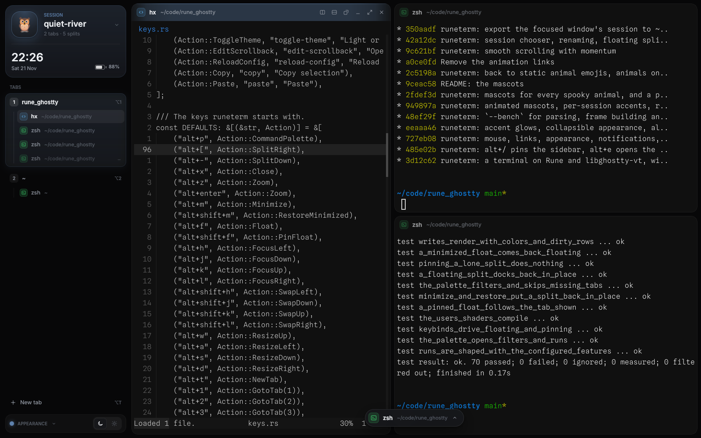
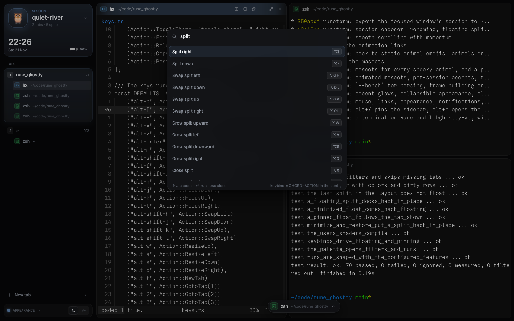
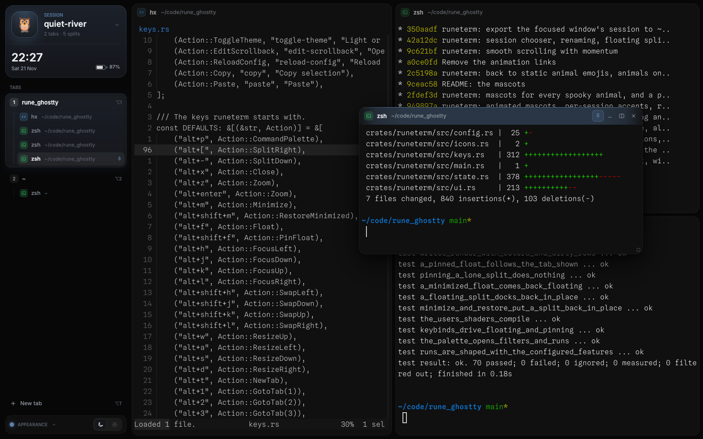
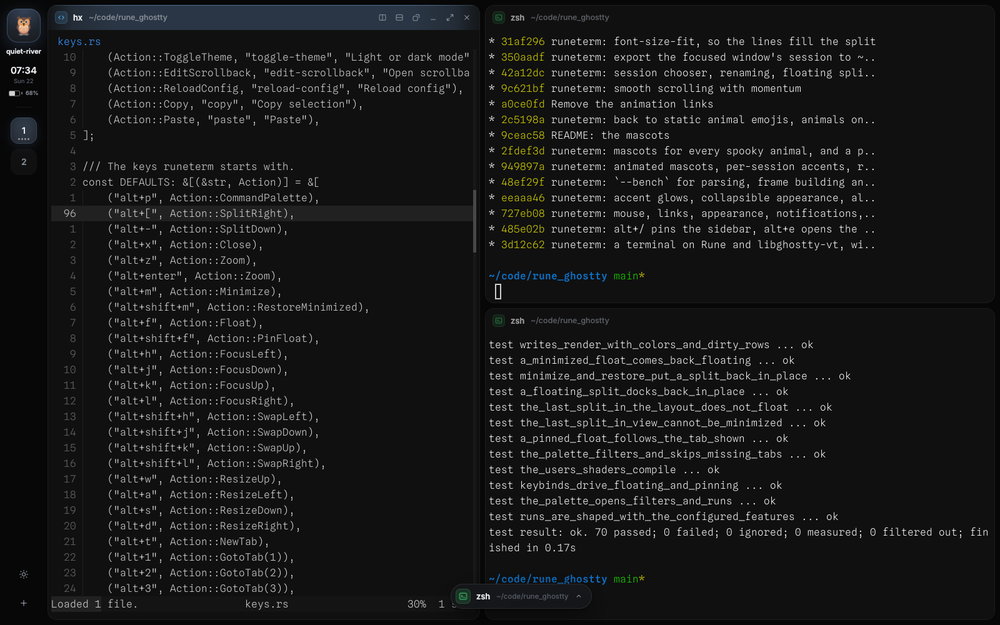
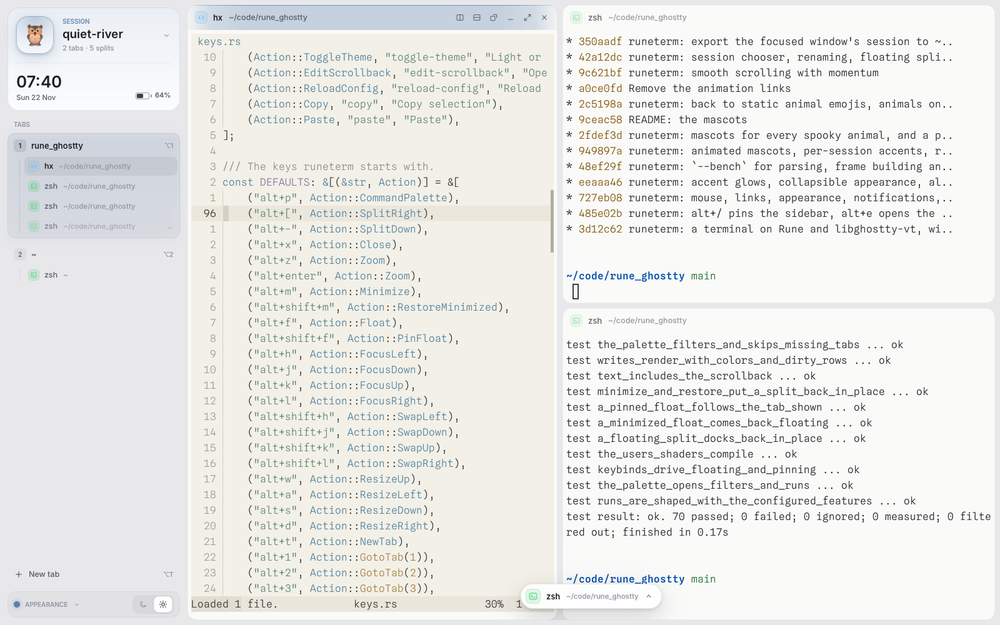

# runeterm

A terminal for Linux built on [Rune](https://github.com/anomalyco/rune) for the window, layout
and animation, and [libghostty-vt](https://github.com/ghostty-org/ghostty) 1.0 for the terminal
itself. Each window is a [spooky](spooky/) session: the daemon owns every pty, so splits and tabs
outlive the window and come back after a reboot.



## Features

- **Sessions that survive.** spooky keeps every shell running when the window closes; open the
  session again (or after a reboot) and the tabs and splits come back as they were. Each session
  gets a two-word name, its own animal and its own accent colour.
- **Splits as surfaces.** Every split is a rounded, shadowed Rune surface, with the grid drawn
  into it by its own wgpu pipeline. Splits can be zoomed, minimized to a pill, or floated above
  the others, and a floating split can be pinned so it stays in view on every tab.
- **A command palette.** Alt+P lists every action with its key; type to filter.
- **Ghostty's config.** The config uses Ghostty's syntax (`keybind` lines too), and the first
  run writes it from Ghostty's: font, colours, cursor and custom shaders, cursor shaders too.
- **Real text rendering.** Text is shaped, so ligatures show as in Ghostty, with
  `font-feature`, `font-style`, `font-variation` and made-up bold and italic for families that
  lack them. Kitty graphics, box drawing drawn to the cell, colour emoji and font fallback.
- **Fast.** It keeps up with the pty end to end, through spooky too (see
  [Performance](#performance)).

<table>
  <tr>
    <td></td>
    <td></td>
  </tr>
  <tr>
    <td align="center">The command palette (Alt+P)</td>
    <td align="center">A floating split, pinned across tabs</td>
  </tr>
</table>



With the sidebar collapsed (Alt+/, or `sidebar = hover`), it shrinks to a rail of the session's
badge, the time, the battery and a tile per tab, and opens over the splits on hover.



Light mode (`theme = light`, or the sun in the sidebar) switches the chrome and the terminal
colours together; the light colours are `light-background`, `light-foreground` and
`light-palette` in the config.

## Build

libghostty-vt is built once into `vendor/`:

```sh
git clone --depth 1 --branch vt-1.0.0 https://github.com/ghostty-org/ghostty vendor/ghostty
(cd vendor/ghostty && zig build -Demit-lib-vt -Doptimize=ReleaseFast --prefix "$PWD/../ghostty-vt")
cargo build --release -p runeterm
```

Set `GHOSTTY_VT_PREFIX` to use a libghostty-vt installed elsewhere. Building the bindings needs
libclang.

Sessions need the `spooky` in [`spooky/`](spooky/), which accepts several controllers. Build it
after libghostty-vt with `cd spooky && zig build -Doptimize=ReleaseFast` (see its README).
Without a daemon, runeterm runs plain local shells (`RUNETERM_LOCAL=1` forces that).

## Use

- `runeterm` opens a new session, first asking whether to open one of the detached or saved
  sessions instead, if there are any (arrows to choose, Enter to open, Esc for a new one).
  `runeterm attach NAME` opens one straight away.
- Rename a session from the picker (the pencil on its row) or by double-clicking its name in
  the sidebar. Change its animal by clicking it, or by right-clicking the badge.
- Mouse: drag to select (twice for a word, three times for a line), middle-click pastes the
  selection, Ctrl+click opens links, and dragging the gap between splits resizes them. Programs
  that use the mouse get it; hold Shift to select instead.
- Scrolling is smooth: the grid follows a trackpad to the pixel and coasts on after a flick, a
  mouse wheel's notches glide in, and it settles on a whole line.
- Crashes are logged to `~/.local/state/runeterm/crash.log`.

### Keys

| Key | Action |
|---|---|
| Alt+P | Command palette |
| Alt+[ / Alt+- | Split right / down |
| Alt+H/J/K/L | Focus the split to the left / below / above / right |
| Alt+Shift+H/J/K/L | Swap with that split |
| Alt+W/A/S/D | Resize |
| Alt+Z or Alt+Enter | Full screen (zoom the split) |
| Alt+M / Alt+Shift+M | Minimize / bring back the last minimized split |
| Alt+F | Float or dock |
| Alt+Shift+F | Pin a floating split across tabs |
| Alt+X | Close the split |
| Alt+T, Alt+1 to 9 | New tab, go to a tab |
| Alt+/ | Pin or unpin the sidebar |
| Alt+E | Open the scrollback in an editor (`scrollback-editor`) |
| Alt+R | Reload the config |
| Ctrl+Shift+C / V | Copy / paste |

Rebind them in the config, as in Ghostty: `keybind = alt+n=minimize`, `keybind = alt+m=unbind`
to give a key back to the terminal, `keybind = clear` to drop every default. A new config lists
every default with each action's name, and the palette has the actions that have no key yet
(next and previous tab, sessions, rename, light or dark).

### Configuration

Settings live in `~/.config/runeterm/config`, written from Ghostty's on the first run; Alt+R
reloads it. Beyond Ghostty's colours, cursor and shaders:

- **Fonts.** `font-family`, plus per style `font-style`, `font-style-bold`, `font-style-italic`
  and `font-style-bold-italic` (a face by name, such as `Light` or `Medium Italic`, or `false`
  for the regular face) and `font-family-bold`, `-italic` and `-bold-italic`.
  `font-feature = -calt, -liga` turns ligatures off, and `ss01` turns a stylistic set on.
  `font-variation` (and `-bold`, `-italic`, `-bold-italic`) sets a variable font's axes
  (`wght=450`). A family with no bold or italic face gets a made-up one, emboldened or slanted;
  `font-synthetic-style = false` (or `no-bold`, `no-italic`, `no-bold-italic`) turns that off.
- **Fit.** `font-size-fit = 3%` lets the line height (and, if that's not enough, the font size)
  move by up to that much, so the lines fill the splits with no blank strip under the last one.
  Dividers snap to whole lines and columns once you let go of them, so a split never ends in a
  part of a line.
- **Sidebar.** `sidebar = pinned` or `hover`, its widths, and whether it shows the time, the
  battery and `user@host`.
- **Appearance.** `theme = dark` or `light`, `accent`, and `accent-colors` for the swatches.
  Each session's accent is picked so no two sessions share one.

## Performance

`runeterm --bench` measures the hot paths in a few seconds, without a window. On a laptop
(release build, libghostty-vt 1.0.0):

| | |
|---|---|
| Parsing plain lines | 266 MB/s |
| Parsing coloured `ls`-style lines | 150 MB/s |
| Parsing full-screen redraws (htop-like) | 424 MB/s |
| Building a full 200x60 frame (6,400 quads, shaped) | 1.18 ms |
| Building a frame with one changed line | 0.037 ms |
| `seq 1 2000000` through a bare pty to /dev/null | 26.2 MB/s |
| ... into runeterm on a local pty | 27.6 MB/s |
| ... into runeterm through spooky | 28.1 MB/s |

Parsing runs 5 to 15 times faster than a pty delivers, a full redraw uses about a seventh of a
120 Hz frame (GPU time not included), and end to end runeterm keeps up with the pty itself,
through spooky too.

The screenshots are rendered headless from scenes in `crates/runeterm/src/ui.rs`:
`runeterm --scene readme --snap splits.png --size 1600x1000` (also `readme-rail`,
`readme-palette` and `readme-float`), run from the repository; the light one is `readme` with
`theme = light`.

## License

MIT, see [LICENSE](LICENSE). spooky started as part of a fork of
[Ghostty](https://github.com/ghostty-org/ghostty), which is MIT licensed too.
